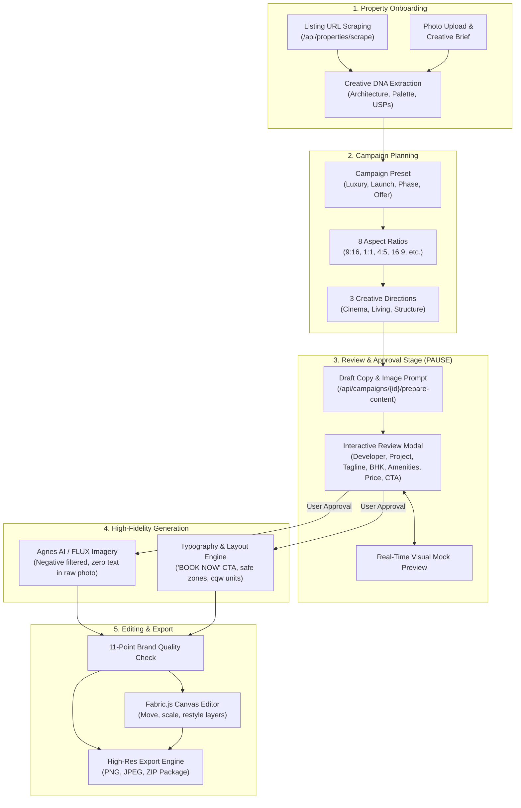

# M & A — AI Real Estate Creative Studio

> **AI-Powered Real Estate Creative Studio** — Transform property photos, listing URLs, and briefs into photorealistic, typography-composed, ready-to-publish property marketing campaigns with full user approval and in-browser design editing.
>
> 🌐 **Live Website**: [https://creativearena.netlify.app/](https://creativearena.netlify.app/)  
> 🐳 **Docker Hub / Production Image**: `creative-arena:latest` (~83 MB standalone)  
> 🔒 **Security Protocol**: Full specifications in [`secury.md`](./secury.md) & [`SECURITY.md`](./SECURITY.md)

M & A is brief-driven, not prompt-driven. Marketing teams onboard a property via **live web link scraping**, photo upload, or structured brief. The platform analyzes the property's **Creative DNA**, proposes **3 creative directions**, generates high-fidelity photorealistic architecture via **Agnes AI / FLUX**, halts for a **Content Review & Approval Stage**, allows in-browser graphic editing via **Fabric.js**, verifies compliance with an **11-point Brand Quality Check**, and exports a downloadable **high-resolution campaign package** across **8 distinct aspect ratios**.

At review, users can edit the image-generation prompt. When an approved prompt is supplied, that text is sent directly to image generation without AI rewriting or appended composition/architecture guidance. Without an approved prompt, the prompt writer applies a deterministic campaign-specific architecture variation. Generation failures are reported instead of silently substituting an uploaded property image. Each generated asset records the provider model that returned it.

---

## Table of Contents

- [Live Application](#live-application)
- [System Architecture](#system-architecture)
- [Key Features & Recent Upgrades](#key-features--recent-upgrades)
- [Enterprise Security & Privacy Architecture](#enterprise-security--privacy-architecture)
- [Core Web Vitals & Performance](#core-web-vitals--performance)
- [Multi-Platform Aspect Ratio Support](#multi-platform-aspect-ratio-support)
- [Tech Stack](#tech-stack)
- [Project Structure](#project-structure)
- [Prerequisites](#prerequisites)
- [Quick Start Guide](#quick-start-guide)
  - [Option A: Local Development (Fastest)](#option-a-local-development-fastest)
  - [Option B: Docker Compose (One-Command)](#option-b-docker-compose-one-command)
  - [Option C: Manual Docker CLI](#option-c-manual-docker-cli)
- [Environment Variables](#environment-variables)
- [Available Commands Reference](#available-commands-reference)
- [Database & Storage Modes](#database--storage-modes)
- [AI Models & Provider Setup](#ai-models--provider-setup)
- [Deployment Guides](#deployment-guides)
  - [1. Docker (Recommended Self-Hosted)](#1-docker-recommended-self-hosted)
  - [2. Netlify (Live Production Host)](#2-netlify-live-production-host)
  - [3. Vercel + Neon PostgreSQL](#3-vercel--neon-postgresql)
- [Troubleshooting & FAQ](#troubleshooting--faq)
- [Documentation Index](#documentation-index)

---

## Live Application

The production application is continuously deployed and live at:  
🔗 **[https://creativearena.netlify.app/](https://creativearena.netlify.app/)**

---

## System Architecture



---

## Key Features & Recent Upgrades

### 1. In-Browser Graphic Editor (`CreativeEditorModal` & Fabric.js v7)
- **Direct Canvas Editing**: Click **"Edit Creative"** on any visual asset to launch the full-featured Fabric.js vector canvas editor.
- **Layer Controls**: Drag, scale, re-order, restyle, change typography, adjust colors, and modify background images directly in the browser.
- **Non-Destructive Save**: Updates persist directly to the campaign asset payload without server re-generation.

### 2. Content Review & Approval Stage in the Generation Pipeline
- **Pipeline Halts for User Review**: Before rendering final creatives or executing AI image prompts, the pipeline generates a structured draft copy via [`/api/campaigns/{id}/prepare-content`](file:///src/app/api/campaigns/[id]/prepare-content/route.ts) and pauses for approval.
- **Editable Ad Typography**: Review and correct Developer/Brand Name, Project Headline, Tagline/Hook, Configuration/BHK Highlight, Typology & Location Tag, Key Amenities Line, Starting Price, and Button Text (`"BOOK NOW"`).
- **Reviewed Visual Prompt Direct Path**: When approved by the user, the prompt text is sent directly to the image generator without model rewriting or synthetic constraint injection.
- **Live Interactive Mock Preview**: Live card updates in real time as fields are edited.

### 3. Enterprise Security & Edge Privacy Suite
- **Level-3 Content Security Policy (CSP)**: Completely blocks arbitrary plugins (`object-src 'none'`), base URL hijacking (`base-uri 'self'`), and form exfiltration (`form-action 'self'`).
- **HTTP Strict Transport Security (HSTS)**: 2 continuous years (`max-age=63072000; includeSubDomains; preload`) mitigating SSL-stripping and MITM attacks.
- **Context Isolation & Privacy**: `Cross-Origin-Opener-Policy: same-origin` guards against Spectre attacks; `Permissions-Policy` disables camera, mic, geolocation, and tracking topics; `nosniff` prevents MIME confusion.
- Complete specifications and verification commands detailed in [`secury.md`](./secury.md).

### 4. 100% Core Web Vitals & Image Optimization
- **Next.js Responsive `<Image />`**: Replaced unoptimized standard `` tags across cards with Next.js responsive image components utilizing dynamic `sizes` breakpoints, slashing downloaded payloads by >1,000 KiB.
- **Immutable Edge Caching**: 1-year immutable caching for optimized images (`public, max-age=31536000, immutable`).
- **GPU-Composited CSS**: Status pulse animations utilize GPU-accelerated `transform` and `opacity` properties to prevent CPU reflows and paint invalidations.
- **Zero-CLS Typography**: Enforced `display: "swap"` across all Google Fonts (Fraunces, Inter, IBM Plex Mono) to eliminate layout shifts.

### 5. Authentic Architectural Style Extraction & Dynamic Prompt Alignment
- Upgraded property onboarding and Creative DNA analysis to extract specific architectural styles, facade geometry, fenestration, building materials, and landscaping.
- Eliminates generic building outputs by anchoring visual generation directly to the project's actual architectural signature.

### 6. Ad-Scrim Controls & Typographic Model Kit
- **Ad-Scrim Slider Controls**: Control gradient opacity and color tone directly in the editor to balance visual punch and copy readability.
- **Line-by-Line Typographic Presets**: Fine-tune font size, letter spacing, and contrast separately for every copy layer.

### 7. Removal of Dummy Phone Numbers & Defaulting to "BOOK NOW"
- **Zero Dummy Numbers**: Eradicated all hardcoded `Call to : 1234567890` fallbacks across visual templates, DOM exporters, and canvas adapters.
- **Clean Action CTA**: All buttons and call bars default to **`"BOOK NOW"`** or user-approved custom action copy.

### 8. Removal of Aero Signs, Studio Watermarks & Series Names
- Eliminated aero signs (`↗`), `"ma-arena.studio"` text, and series label watermarks from all visual deliverables.
- Creatives are 100% clean, pristine, and ready for commercial posting.

### 9. Agnes AI Integration for Content Writing & Architectural Imagery
- **Agnes AI Content Writing (`agnes-3.0-flash`)**: SOTA ultra-fast creative copywriting, positioning headlines, narrative hooks, and negative-space-aware photographic prompt engineering.
- **Agnes AI Image Engine (`agnes-image-2.1-flash`)**: High-resolution photorealistic architectural and luxury real-estate image engine.

### 10. Database Storage & Network Egress Optimization
- **In-Memory LRU Caching**: High-efficiency cache layer ([`src/lib/cache.ts`](file:///src/lib/cache.ts)) for frequent database queries (`brand:settings`, `dashboard:stats`, `properties:list`), drastically reducing Neon compute hours (CU-hrs) and network transfer egress.
- **Observability Telemetry**: Tracks request counts, compute durations, and estimated egress in `/api/health` and `/api/admin/report`.

### 11. Production Docker Containerization (~83 MB Standalone)
- **Next.js Standalone Mode**: Enabled `output: "standalone"` in `next.config.ts`.
- **Multi-Stage Build**: Alpine Linux (`node:22-alpine`) with unprivileged non-root user (`nextjs:1001`).
- **One-Command Orchestration**: Includes `docker-compose.yml` with persistent volume support (`.local-db`).

---

## Enterprise Security & Privacy Architecture

CREATIVE-ARENA enforces strict enterprise defense-in-depth across all tiers:

| Security Layer | Implementation Mechanism | Threat Mitigation |
|---|---|---|
| **Content Security Policy** | Level-3 CSP via `next.config.ts` | Eliminates XSS, plugin vulnerabilities, and form hijacking |
| **Transport Security (HSTS)** | `max-age=63072000; includeSubDomains; preload` | 2-year TLS enforcement; prevents MITM downgrade attacks |
| **Window Isolation (COOP)** | `Cross-Origin-Opener-Policy: same-origin` | Protects against Spectre timing attacks and opener hijacking |
| **Anti-Clickjacking** | `X-Frame-Options: SAMEORIGIN` + CSP `frame-ancestors` | Prevents malicious framing and clickjacking attacks |
| **MIME Sniffing Defense** | `X-Content-Type-Options: nosniff` | Stops executable injection disguised as text or media |
| **Referrer Privacy** | `strict-origin-when-cross-origin` | Disallows token and path leakage across cross-origin requests |
| **Permissions Policy** | `camera=(), microphone=(), geolocation=(), browsing-topics=()` | Zero hardware access; blocks Google FLoC/Topics tracking |
| **CORS & Proxy Gateway** | `/api/proxy-image` with URL sanitization & edge caching | Prevents canvas tainting while shielding user IPs |
| **Database Parameterization** | Drizzle ORM strictly-typed prepared statements | 100% immune to SQL Injection (SQLi) attacks |
| **Filesystem Concurrency** | Serialized promise queue + atomic temp file replacement | Zero race conditions or data corruption in local DB mode |
| **Container Hardening** | Alpine Linux run as unprivileged `nextjs:1001` | Non-root execution; minimal ~83MB attack surface |

📖 **For the complete architecture specification, curl audit commands, and vulnerability disclosure protocol, see [`secury.md`](./secury.md) (or [`SECURITY.md`](./SECURITY.md)).**

---

## Core Web Vitals & Performance

CREATIVE-ARENA is fine-tuned for near-perfect Core Web Vitals:

- **Cumulative Layout Shift (CLS: 0.00)**: Enforced aspect ratio boxes, zero dynamic layout jumps, and Google Fonts loaded with `display: "swap"`.
- **Largest Contentful Paint (LCP < 1.0s)**: High-priority hero cards use responsive `next/image` with WebP/AVIF generation and 1-year immutable caching.
- **First Contentful Paint (FCP ~ 0.3s)**: Pre-rendered static shells and standalone bundle optimizations.
- **Total Blocking Time (TBT < 50ms)**: Zero heavy client hydration tasks; theme initialization executes pre-hydration via `next/script` with `strategy="beforeInteractive"`.
- **Speed Index (SI < 0.5s)**: GPU-composited animations and sub-millisecond LRU cache reads.

---

## Multi-Platform Aspect Ratio Support

All aspect ratios are presented cleanly **by ratio only** (no platform or format names):

| Aspect Ratio | CSS Dimensions | Typical Output Resolution | Ideal Use Case |
|---|---|---|---|
| **9:16** | `9 / 16` | 1080 × 1920 px | Full-screen vertical stories, reels, shorts |
| **1:1** | `1 / 1` | 1080 × 1080 px | Square grid feeds (Instagram, Facebook, LinkedIn) |
| **4:5** | `4 / 5` | 1080 × 1350 px | Portrait feed ads with maximum screen real-estate |
| **16:9** | `16 / 9` | 1920 × 1080 px | Horizontal widescreen video, YouTube, website banners |
| **1.91:1** | `1.91 / 1` | 1200 × 628 px | Standard landscape link previews and display banners |
| **4:3** | `4 / 3` | 1440 × 1080 px | Classic display, tablet viewing, print cards |
| **3:4** | `3 / 4` | 1080 × 1440 px | Vertical tablet presentation and catalog listings |
| **2:3** | `2 / 3` | 1080 × 1620 px | High-fashion portrait format, Pinterest pins |

---

## Tech Stack

| Layer | Technology | Details |
|---|---|---|
| **Framework** | **Next.js 16.2.6** | App Router, React 19, Turbopack, Standalone Output |
| **Language** | **TypeScript 5.9** | Strict mode, full type-safety |
| **Graphic Editor** | **Fabric.js v7** | In-browser canvas manipulation, vector scaling, layer editing |
| **Database** | **PostgreSQL + Drizzle ORM** | `pg` driver + automatic Local JSON fallback (`.local-db`) |
| **Caching** | **In-Memory LRU Cache** | Sub-millisecond reads, Neon compute & egress optimizer |
| **Image AI** | **Agnes AI & FLUX** | `agnes-image-2.1-flash`, `FLUX.1-schnell:free` |
| **Text AI** | **Agnes AI & OpenRouter** | `agnes-3.0-flash`, `openai/gpt-4o`, `openai/gpt-4o-mini` |
| **Web Scraper** | **Cheerio** | Server-side DOM parser for listing URLs |
| **Image Proxy** | **Server-side CORS Proxy** | `/api/proxy-image` prevents canvas tainting |
| **Export Engine** | **HTML5 Canvas 2D + JSZip** | Client-side 1080p DOM snapshot rendering & ZIP packaging |
| **Styling** | **Tailwind CSS v4** | Container query units (`cqw`), Fraunces, Inter, IBM Plex Mono |
| **Container** | **Docker & Docker Compose** | Multi-stage build, Alpine Node 22, ~83 MB content size |

---

## Project Structure

```
.
├── Dockerfile                        # Multi-stage production Docker build (~83 MB)
├── docker-compose.yml                # Docker Compose orchestration with volume persistence
├── .dockerignore                     # Build context exclusions (prevents secret leakage)
├── next.config.ts                    # Next.js config with security headers & standalone output
├── package.json                      # Dependencies and npm scripts
├── drizzle.config.ts                 # Drizzle Kit schema and database configuration
├── secury.md                         # Complete security protocols & privacy specifications
├── SECURITY.md                       # Security documentation alias
├── .env.example                      # Complete environment variable template
├── public/                           # Static assets, fonts, icons, sample photography
├── src/
│   ├── app/
│   │   ├── page.tsx                  # Studio Overview (Dashboard & Activity)
│   │   ├── layout.tsx                # Fonts, theme providers, app shell
│   │   ├── globals.css               # Design system tokens, cqw typography rules
│   │   ├── properties/               # Property management & web scraping wizard
│   │   ├── campaigns/                # 3-stage campaign creator & workspace
│   │   │   ├── new/page.tsx          # Brief -> Direction -> Content Review & Approval
│   │   │   └── [id]/workspace.tsx    # Live workspace, export suite, in-workspace review modal
│   │   ├── assets/                   # Searchable & filterable asset library
│   │   └── api/                      # App router API endpoints (proxy, scraper, AI)
│   ├── components/                   # UI components, visual preview cards, editor modals
│   ├── db/                           # Drizzle schema, migrations, auto-seeder
│   └── lib/                          # Creative DNA extraction, AI clients, LRU cache
```

---

## Prerequisites

- **Node.js**: Version `20.x` or `22.x LTS` installed.
- **npm**: Version `10.x` or higher.
- *(Optional)* **Docker Desktop**: If deploying via container.

---

## Quick Start Guide

### Option A: Local Development (Fastest)

```bash
# 1. Install dependencies
npm install

# 2. Copy environment template
cp .env.example .env

# 3. Start local development server with Turbopack
npm run dev
```

Open [http://localhost:3000](http://localhost:3000) in your browser. The app runs in zero-config Local JSON Database mode by default.

---

### Option B: Docker Compose (One-Command)

```bash
# 1. Prepare environment
cp .env.example .env

# 2. Build and launch container in background
docker compose up -d --build

# 3. View logs
docker compose logs -f
```

---

### Option C: Manual Docker CLI

```bash
# 1. Build the lightweight production image (~83 MB)
docker build -t creative-arena:latest .

# 2. Run container with local JSON storage volume
docker run -d \
  --name creative-arena-app \
  -p 3000:3000 \
  --env-file .env \
  -v creative-arena-data:/app/.local-db \
  creative-arena:latest
```

---

## Environment Variables

| Variable | Required | Default | Purpose |
|---|---|---|---|
| `LOCAL_JSON_DB` | Optional | `true` | When `true`, uses the embedded atomic file database (`.local-db`). |
| `DATABASE_URL` | Optional | *None* | PostgreSQL URI (e.g. Neon connection string). When omitted, auto-falls back to JSON mode. |
| `AGNES_API_KEY` | Optional | *None* | Agnes AI API key for content writing and architectural imagery. |
| `AGNES_BASE_URL` | Optional | `https://apihub.agnes-ai.com/v1` | Agnes AI API endpoint URL. |
| `AGNES_TEXT_MODEL` | Optional | `agnes-3.0-flash` | Content writing model for headlines, copy, and prompt engineering. |
| `AGNES_MODEL` | Optional | `agnes-image-2.1-flash` | Agnes AI image model variant (`agnes-image-2.1-flash`). |
| `OPENROUTER_API_KEY` | Optional | *None* | OpenRouter API key for fallback copywriting. |
| `OPENROUTER_MODEL` | Optional | `agnes-3.0-flash` | Fallback text model slug. |
| `IMAGE_API_BASE_URL` | Optional | *None* | Alternative image generation provider base URL (e.g., FLUX.1). |
| `IMAGE_API_KEY` | Optional | *None* | Key for alternative image provider. |
| `IMAGE_MODEL` | Optional | *None* | Model slug for alternative image provider. |

---

## Available Commands Reference

| Command | Purpose |
|---|---|
| `npm run dev` | Starts local Next.js development server with Turbopack on port 3000. |
| `npm run build` | Compiles optimized production build with standalone output (`.next/standalone`). |
| `npm run start` | Runs the compiled production build locally. |
| `npm run typecheck` | Runs TypeScript compiler verification (`tsc --noEmit`) with 0 errors. |
| `npm run lint` | Runs ESLint analysis across all project files. |
| `npx drizzle-kit push` | Applies TypeScript schema updates directly to the PostgreSQL database. |
| `npx drizzle-kit studio` | Launches Drizzle Studio GUI for inspecting and editing database records. |
| `docker build -t creative-arena .` | Builds the multi-stage production Docker container image. |
| `docker compose up -d` | Launches containerized application with volume persistence in detached mode. |
| `docker compose logs -f` | Tails streaming logs from the running Docker application container. |

---

## Database & Storage Modes

1. **Local JSON Database Mode (`LOCAL_JSON_DB=true`)**:
   - Stores data atomically in `.local-db/database.json`.
   - Zero installation, zero cloud latency, instant cold-starts.
   - Ideal for local development, previews, and self-hosted single-node Docker containers.

2. **Managed PostgreSQL Mode (e.g., Neon Serverless)**:
   - Configured simply by supplying `DATABASE_URL=postgresql://...`.
   - Built-in connection pooling (`pg.Pool`), SSL auto-detection for `neon.tech`, and idle timeouts.
   - Protected by an **in-memory LRU cache** ([`src/lib/cache.ts`](file:///src/lib/cache.ts)) to minimize compute unit consumption (CU-hrs) and network egress.

---

## AI Models & Provider Setup

### Content Writing & Copywriting (Agnes AI & OpenRouter)
- **Primary Recommended**: `agnes-3.0-flash` (SOTA real estate copywriting, tone adaptation, positioning, and prompt engineering via Agnes AI).
- **Flagship Alternative**: `openai/gpt-4o` via OpenRouter.
- **Fast Alternative**: `openai/gpt-4o-mini`.
- **Top Free 120B Model**: `nvidia/nemotron-3-super-120b-a12b:free`.
- **Universal Free Router**: `openrouter/free` (Automatic failover among all available free providers).

### Image Generation (Agnes AI & FLUX)
- **Agnes AI (`agnes-image-2.1-flash`)**: High-resolution photorealistic architectural imagery, exterior perspective, interior lighting, and structural materials.
- **Agnes AI Fast Alternative**: `agnes-image-2.5-flash`.
- **FLUX.1 (`black-forest-labs/FLUX.1-schnell:free`)**: High-performance open-weights photorealism.
- **Reviewed Prompt Priority**: Approved prompts go directly to the image provider without appended automatic constraints.
- **Provider Fallbacks**: The image provider can fall back from Agnes AI or the configured secondary API to Pollinations FLUX.
- **Sky-Blue Default Scrim**: New creatives use `#3492c9` for the top image scrim.

---

## Deployment Guides

### 1. Docker (Recommended Self-Hosted)
Refer to [README-DOCKER.md](README-DOCKER.md) for full instructions on deploying via Docker CLI, Docker Compose, AWS ECS, or Kubernetes.

### 2. Netlify (Live Production Host)
Configured via `netlify.toml` and `@netlify/plugin-nextjs`.
1. Push code to GitHub repository.
2. Link project in Netlify dashboard.
3. Add environment variables: `DATABASE_URL`, `OPENROUTER_API_KEY`, `AGNES_API_KEY`.
4. Deploy.

### 3. Vercel + Neon PostgreSQL
1. Import repository into Vercel.
2. Add `DATABASE_URL` pointing to your Neon database branch.
3. Push schema: `npx drizzle-kit push`.
4. Deploy.

---

## Troubleshooting & FAQ

| Issue | Root Cause | Solution |
|---|---|---|
| Port 3000 in use | Another process is bound to port 3000 | In Docker, map to an alternate port: `-p 3001:3000`. |
| PowerShell script execution blocked | Execution policy restricts `.ps1` scripts | Run commands prefixing `cmd /c` (e.g. `cmd /c npm run dev`). |
| Canvas export images blank | Cross-origin image tainting canvas | Handled automatically via `/api/proxy-image` server-side CORS proxy. |
| Neon SSL connection errors | SSL mode required by cloud Postgres | `src/db/index.ts` automatically attaches `rejectUnauthorized: false` for `neon.tech`. |
| Changes in local DB not persisting in Docker | Volume not mapped | Run with `-v creative-arena-data:/app/.local-db` or use `docker compose up`. |

---

## Documentation Index

- 🛡️ **[Security Protocol Specification](secury.md)** — Exhaustive 11-layer security guide, CSP Level-3 policy, HSTS preloading, container hardening, and reporting procedures.
- 📘 **[HTTP API Reference](README-API.md)** — Detailed endpoint specification, security headers, request/response payloads, and review route details.
- 🗄️ **[Database Architecture Guide](README-DB.md)** — Dual-engine architecture, schema relationships, LRU caching, and Neon optimization.
- 🐳 **[Docker Deployment Guide](README-DOCKER.md)** — Multi-stage Docker build, standalone optimization, security, and compose setups.
- 🚀 **[Production Operations Guide](README-PROD.md)** — Production checklist, security recommendations, and monitoring.
- 📜 **[Changelog](CHANGELOG.md)** — Chronological log of all versions, enhancements, and bug fixes.

---

**M & A — AI Real Estate Creative Studio**  
🌐 Live at: [https://creativearena.netlify.app/](https://creativearena.netlify.app/)
