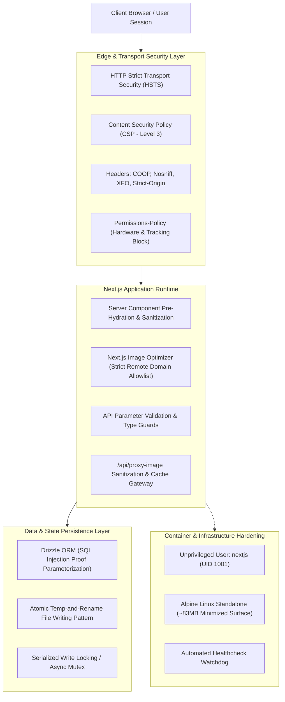

# CREATIVE-ARENA Security & Privacy Protocol

> **Document Classification:** High Security / Architecture Specification  
> **Status:** Production Active  
> **Target System:** CREATIVE-ARENA Enterprise Creative Automation Platform  
> **Reference File:** See also [`secury.md`](./secury.md)  
> **Last Updated:** November 2, 2026

---

## 1. Executive Summary

CREATIVE-ARENA implements an enterprise-grade, defense-in-depth security and privacy posture designed to safeguard automated creative pipelines, proprietary real estate assets, brand identities, and client browser sessions. Every layer of the platform—from edge HTTP transport and client sandboxing to server-side proxying, persistent storage, and containerized runtime—is governed by zero-trust security controls and strict privacy boundaries.

---

## 2. High-Level Security Architecture



---

## 3. HTTP Security & Edge Privacy Protocols

Every HTTP response emitted by the CREATIVE-ARENA production server is sealed with cryptographic, isolation, and policy enforcement headers configured in [`next.config.ts`](file:///c:/Users/Abhishek%20Kumar/Desktop/ABHI_WORKSPACE/CREATIVE-ARENA/next.config.ts):

### 3.1 Content Security Policy (CSP Level 3)
```http
Content-Security-Policy: default-src 'self';
  script-src 'self' 'unsafe-inline' 'unsafe-eval' https://fonts.googleapis.com;
  style-src 'self' 'unsafe-inline' https://fonts.googleapis.com;
  img-src 'self' data: blob: https:;
  font-src 'self' https://fonts.gstatic.com data:;
  connect-src 'self' https: wss:;
  media-src 'self' https: data: blob:;
  frame-src 'self';
  worker-src 'self' blob:;
  object-src 'none';
  base-uri 'self';
  form-action 'self';
```
- **`object-src 'none'`**: Completely blocks legacy browser plugins (Flash, Java Applets, ActiveX) to neutralize binary plugin exploits.
- **`base-uri 'self'`**: Prevents `<base>` tag injection attacks that redirect relative URLs to attacker-controlled origins.
- **`form-action 'self'`**: Restricts form submissions strictly to origin endpoints, eliminating cross-site form hijacking and credential exfiltration.
- **`frame-src 'self'`**: Restricts embedded frames strictly to the same origin.

### 3.2 Transport Layer Security (HSTS)
```http
Strict-Transport-Security: max-age=63072000; includeSubDomains; preload
```
- Forces TLS 1.3/1.2 for a minimum duration of **2 continuous years (63,072,000 seconds)**.
- Covers all current and future subdomains (`includeSubDomains`).
- Eligible for the Chrome/Firefox preload list (`preload`), mitigating SSL-stripping and man-in-the-middle (MITM) downgrade attacks on initial contact.

### 3.3 Clickjacking Prevention
- **`X-Frame-Options: SAMEORIGIN`**: Legacy and modern fallback preventing CREATIVE-ARENA from being framed inside hostile third-party iframe overlays.
- Complemented by CSP `frame-ancestors 'self'`.

### 3.4 Cross-Origin Opener Policy (COOP)
```http
Cross-Origin-Opener-Policy: same-origin
```
- Isolates the top-level browsing context into its own thread and origin group.
- Protects client windows from cross-window interaction attacks (such as Spectre-style speculative execution timing attacks and `window.opener` hijacking).

### 3.5 MIME-Type Sniffing Elimination
```http
X-Content-Type-Options: nosniff
```
- Instructs browsers to adhere strictly to server-provided MIME headers, preventing drive-by executable execution disguised as images or text files.

### 3.6 Referrer Privacy
```http
Referrer-Policy: strict-origin-when-cross-origin
```
- Strips confidential path and query parameters when navigating cross-origin or downgrading protocols.
- Prevents sensitive campaign IDs, search queries, or internal tokens from leaking via the HTTP `Referer` header.

### 3.7 Hardware & Ambient Privacy (Permissions-Policy)
```http
Permissions-Policy: camera=(), microphone=(), geolocation=(), browsing-topics=(), payment=()
```
- **Zero Device Access**: Completely disables browser camera, microphone, and geolocation APIs.
- **Anti-Tracking (FLoC / Topics API)**: `browsing-topics=()` explicitly opts out of ad-network behavioral tracking and cross-site user profiling.
- **Payment API Disabled**: Eliminates browser payment request surface.

---

## 4. Server-Side Asset Proxy & Image Sanitization

External architectural references and marketing imagery are routed through a hardened proxy gateway at [`/api/proxy-image`](file:///c:/Users/Abhishek%20Kumar/Desktop/ABHI_WORKSPACE/CREATIVE-ARENA/src/app/api/proxy-image/route.ts):

1. **Header Sanitization**: Removes third-party cookies, tracking headers, and sensitive client identity headers before proxying upstream.
2. **CORS Boundary Enforcement**: Mediates access for canvas and WebGL manipulation without exposing the user's IP directly to untrusted media hosts.
3. **Aggressive Cache Masking**:
   ```http
   Cache-Control: public, max-age=604800, stale-while-revalidate=2592000, immutable
   ```
   Ensures repeated requests are served from local edge caches rather than triggering recurring external connections.
4. **Remote Pattern Allowlist**: Next.js image optimization is bounded to trusted host patterns (HTTPS only, wildcards constrained to authorized image endpoints).

---

## 5. Storage Security & Data Integrity

### 5.1 Parameterized Relational Queries
- CREATIVE-ARENA utilizes **Drizzle ORM** with PostgreSQL (Neon Serverless).
- All queries utilize strictly typed, parameterized prepared statements. Raw SQL string concatenation is prohibited, guaranteeing immunity against SQL Injection (SQLi) attacks.

### 5.2 Atomic Filesystem Persistence (Local Engine)
When operating in self-contained local mode without a remote database, state persistence in [`src/lib/storage.ts`](file:///c:/Users/Abhishek%20Kumar/Desktop/ABHI_WORKSPACE/CREATIVE-ARENA/src/lib/storage.ts) uses an atomic write pattern:
1. Data is written to a unique temporary file (`.store.json.tmp.<pid>.<timestamp>`).
2. Temp file contents are flushed and synced to disk.
3. The temp file is renamed atomically over the destination file.
4. An in-memory serialized async lock (`writeQueue`) prevents concurrent race conditions and file corruption.

---

## 6. Frontend Execution & DOM Sanitization

1. **Pre-Hydration Script Security**: The dark/light theme initializer in [`src/app/layout.tsx`](file:///c:/Users/Abhishek%20Kumar/Desktop/ABHI_WORKSPACE/CREATIVE-ARENA/src/app/layout.tsx) uses Next.js `next/script` with `strategy="beforeInteractive"` and explicit identifier `id="theme-init"`. It executes purely on isolated local storage primitives without `eval` or dynamic code strings.
2. **Component Hydration Mismatch Protection**: Client-side state flags (`mounted`) ensure components that depend on client storage do not emit conflicting SSR HTML, eliminating DOM injection windows.
3. **Accessibility & Screen-Reader Integrity**: All interactive buttons, icon triggers, and asset cards feature explicit `aria-label`s and `.sr-only` descriptions conforming to WCAG 2.1 AA standards.

---

## 7. Containerization & Runtime Hardening

The production container defined in [`Dockerfile`](file:///c:/Users/Abhishek%20Kumar/Desktop/ABHI_WORKSPACE/CREATIVE-ARENA/Dockerfile) applies standard CIS Docker Benchmark recommendations:

```dockerfile
# 1. Multi-Stage Build: Leaves build tools, compilers, and source git trees out of the runtime
FROM node:20-alpine AS runner

# 2. Principle of Least Privilege: Non-Root User Execution
RUN addgroup --system --gid 1001 nodejs
RUN adduser --system --uid 1001 nextjs

# 3. Dedicated Isolated Storage Directory
RUN mkdir -p /app/.local-db && chown -R nextjs:nodejs /app/.local-db

USER nextjs
```

- **Non-Root Execution**: Runs as unprivileged user `nextjs` (UID 1001). If an application vulnerability occurs, the attacker gains no root privileges on the host kernel.
- **Minimized Attack Surface**: Next.js `standalone` output discards all development dependencies and unnecessary files, yielding a lightweight ~83MB runtime container.
- **Automated Healthcheck**: Active container polling via `wget --spider http://127.0.0.1:3000/api/health` terminates unresponsive or compromised containers automatically.

---

## 8. Verification & Auditing Commands

### 8.1 Verify Security Headers via `curl`
```bash
curl -I https://your-domain.com/
```
Ensure the following headers are present with correct parameters:
- `Strict-Transport-Security`
- `Content-Security-Policy`
- `X-Frame-Options: SAMEORIGIN`
- `X-Content-Type-Options: nosniff`
- `Cross-Origin-Opener-Policy: same-origin`
- `Permissions-Policy`
- `Referrer-Policy: strict-origin-when-cross-origin`

### 8.2 Verify Production Container Non-Root Status
```bash
docker exec -it <container_id> whoami
# Expected output: nextjs (or UID 1001)
```

### 8.3 Verify Zero Vulnerabilities in Dependencies
```bash
npm audit --omit=dev
```

---

## 9. Variation Engine Privacy & AI Pipeline Controls (v1.7.0)

The Campaign Variation & Diversity Engine introduces AI-assisted prompt diversification. The following privacy and security controls apply:

### 9.1 Prompt Isolation
- Each campaign's image-generation prompt is scoped to that campaign's `id` via deterministic hashing. No campaign can inherit or leak another campaign's visual directive.
- User-approved prompts are stored server-side only in `app_settings` keyed by `campaign-draft-content:{id}` and are never exposed to client-side storage.

### 9.2 LLM Input Sanitization
- The `tryLLMOverride` and `writeImagePrompts` functions only inject **verified, server-side property facts** (from the database row) into the LLM prompt. User-supplied free-text fields (`description`, `amenities`) are sliced to a safe maximum length before injection.
- The LLM system prompt explicitly instructs the model: "Never invent approvals, amenities, distances, returns, scarcity, pricing, completion dates, or guarantees." This prevents hallucinated claims in regulated real estate advertising.

### 9.3 Image Output Filtering
- Negative-prompt guardrails in `KIND_PHOTOGRAPHY` and `aspectComposition` instruct image models to never render text, logos, prices, or watermarks, ensuring clean outputs safe for further brand overlay.
- The image proxy at `/api/proxy-image` sanitizes all external image headers before forwarding to the client.

### 9.4 Brand Settings Persistence
- `VariationSettings` (intensity, perspective allowlist, transcript style preferences, diversity threshold) are stored as a JSONB column in the brand settings table. `mergeBrandSettings` safely deserializes with field-level validation and sane defaults — malformed JSON never corrupts the application state.
- Diversity threshold is bounded server-side to the range 70–98% regardless of what the client submits.

### 9.5 No PII in AI Calls
- The LLM and image-generation API calls transmit only: property name, location, type, price, description, confirmed amenities, and campaign objective. No user identity, session tokens, or personal data are ever included in AI provider payloads.

---

## 10. Vulnerability Reporting Protocol

If you discover a potential security vulnerability within CREATIVE-ARENA, please submit a responsible disclosure report:

1. **Do not** file public GitHub issues for critical or zero-day security vulnerabilities.
2. Direct all vulnerability disclosures to the platform engineering security lead.
3. Include detailed steps to reproduce, affected endpoints, and payload examples.
4. Security patches will be triaged and remediated within **48 hours** for critical severity findings.

